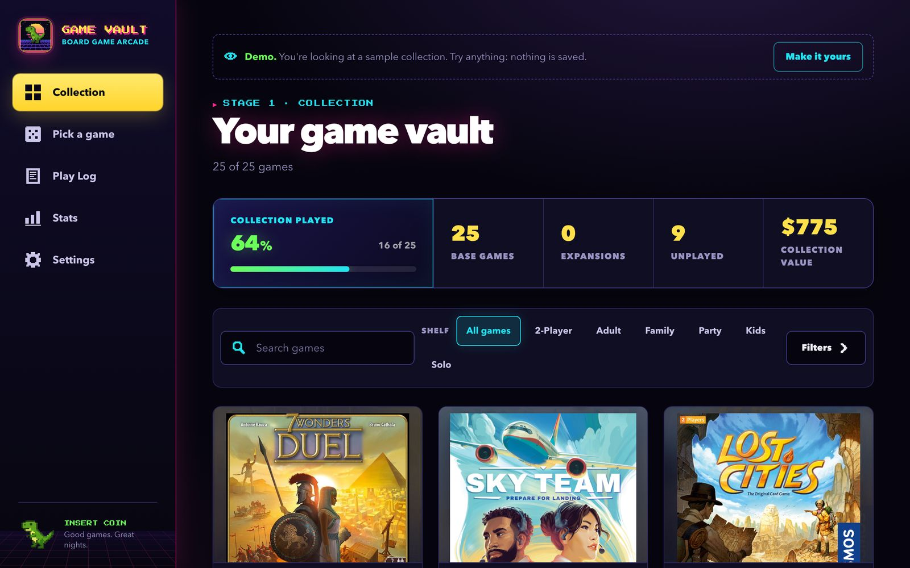

# Game Vault

A board game collection app that runs on a Google Sheet you own: collection browser, game picker, play log, and head-to-head stats staged as a pixel dinosaur duel.

- **Site and demo:** https://jseggs.github.io/game-vault/
- **Set up your own:** https://jseggs.github.io/game-vault/setup.html

## How it works

Game Vault is a static web app with no server of its own. Each person copies a Google Sheet template that carries a small script. Deployed as a web app, that script is the only backend: it reads and writes the one spreadsheet it lives in.

- The first device to connect becomes the owner. Other devices join with invite links.
- A family link can browse and log plays. It never receives prices or notes, and it cannot add games.
- A view-only link shows the collection and each player's favorites to anyone. It never receives prices, notes, plays, or stats, and every write is refused. It opens without touching the visitor's own Game Vault connection.
- Access keys live in the script's properties. The sheet is never published to the web.
- With no sheet connected, the app runs as a demo on a bundled sample collection. Nothing is saved.

Setup takes about five minutes and needs no coding. The [setup guide](https://jseggs.github.io/game-vault/setup.html) walks through it.

## What is in this repository

| Path | What it is |
|---|---|
| `index.html` | Landing page |
| `app.html` | The app. `app.html?tab=stats` (or `picker`, `plays`, `settings`) opens on that screen |
| `setup.html` | Setup guide |
| `config.js` | Project links: template copy link, lookup service, source, optional donation page |
| `sheet/` | The template workbook, the script that goes inside it, and its permission list |
| `bgg-service/` | The BoardGameGeek lookup service the maintainer hosts |
| `tools/` | Template builder and local stand-ins for testing without Google or BoardGameGeek |

## Hosting your own copy

Fork the repository and serve it from any static host. To run fully independently, publish your own master sheet (`sheet/README.md`), host your own lookup service with your own BoardGameGeek token (`bgg-service/README.md`), and put both addresses in `config.js`.

## BoardGameGeek lookup

Settings has a BoardGameGeek card for the owner: add a game by name, or import a BGG user's owned games. It appears only when `bggServiceUrl` is set in `config.js`. The service lives in `bgg-service/` (see its README, including the note about BoardGameGeek's terms). Games are saved by the sheet's own script through the owner-only `saveGames` action, which fills empty BoardGameGeek columns and never overwrites what is already in a row.

## Project links

`config.js` holds the template copy link, the source code link, and an optional donation link. Empty values hide the matching button, so nothing dead is ever shown.

## Data contract

The app talks only to the web app URL of the person's own sheet script (`sheet/Code.gs`).

- `GET ?action=claim` makes the first caller the owner and returns `ownerKey`. Later calls are refused.
- `GET ?action=data&key=…` returns `{status, version, role, games, plays, players, stats}`. Rows are objects keyed by the sheet's column headers. `role` is `owner`, `family`, or `viewer`. Owners also receive `familyKey` and `viewKey`. Family access never receives `Price Paid`, `Notes`, or stats; viewers also receive no plays.
- `POST` with a JSON body containing `key` and `action` (`add`, `delete`, `rate`, `exclude`, `ping`, and the owner-only `saveGames`) writes to the sheet. Viewers can only `ping`.

## Running locally

Serve this folder with any static server, for example `python3 -m http.server` from inside it, and open the address it prints. To test connecting without Google, see "Testing without Google" in `sheet/README.md`.

## Credits and license

Game data and cover images come from [BoardGameGeek](https://boardgamegeek.com). Game Vault is not affiliated with BoardGameGeek.

MIT license. See `LICENSE`.
